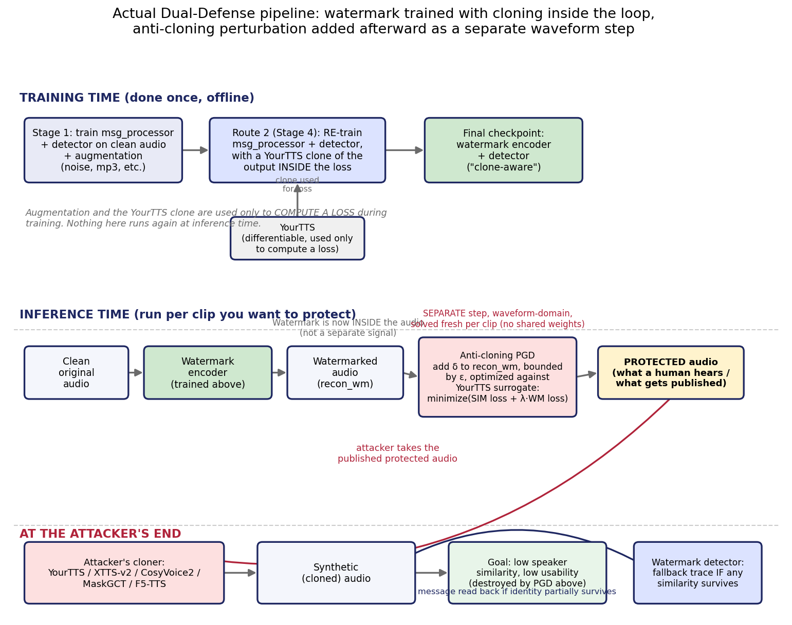

# Dual-Defense Audio Protection

**One published recording that carries a watermark which survives voice cloning, and a protective perturbation that makes the clone less like the speaker.**

*Final results, 2026-10-27.* §0 is the final state of the thesis. Everything after §0 is the development history (earlier watermark checkpoints and earlier perturbation variants). It is kept for provenance, and where it differs from §0, §0 wins.

---

## 0. Final results

### 0.1 The system in one paragraph

A 16-bit message is embedded with a VoiceMark-style codec watermark. Its message encoder and detector are fine-tuned (LoRA) with a **differentiable cloner in the training loop**, so the detector learns to read what survives cloning (*clone-aware watermark*). The *quality-tuned* version adds VoiceMark's perceptual losses and augmentation and voice-activity terms. On top of the watermarked clip, a **protective perturbation** is computed per clip by projected gradient descent through F5-TTS, used as a **stand-in (surrogate) cloner**:
- it pushes the clone's voice away from the speaker on three speaker verifiers;
- a second term keeps the message readable;
- its size follows the speech loudness envelope (peak 0.015, floor 0.003), with 40 steps of 0.0015.

The attacker then clones the published clip with a zero-shot cloner. Every clip is judged three ways:
- **sound quality:** PESQ and STOI against the original;
- **identity:** the share of clones that a held-out verifier, Resemblyzer, accepts as the speaker at a calibrated threshold;
- **traceability:** traced means at least 13 of 16 bits read from the clone.

### 0.2 Baseline reproduced

Official VoiceMark (Hugging Face release, hash-checked), in the paper's setting: LibriSpeech test-clean, full prompt, unseen text, 200 clips from 40 speakers.

| Cloner | Paper ACC | Our run | Gap |
|---|---:|---:|---:|
| F5-TTS | 0.979 | 0.965 | 0.014 |
| MaskGCT | 0.957 | 0.938 | 0.019 |
| CosyVoice 2 | 0.964 | 0.960 | 0.004 |

### 0.3 Watermark: clone-aware training beats VoiceMark

**In VoiceMark's own setting** (same 200 clips, paired):

| Cloner | VoiceMark | Clone-aware | Difference | p (Wilcoxon) | Traced |
|---|---:|---:|---:|---:|---|
| F5-TTS | 0.965 | 0.985 | +0.020 | 4e-4 | 98.5% → 99% |
| MaskGCT | 0.938 | 0.973 | +0.036 | 3e-5 | 93% → 97.5% |
| CosyVoice 2 | 0.960 | 0.983 | +0.023 | 3e-4 | 94.5% → 98% |

**Across 15 combinations** (5 cloners × 3 test sets: LibriSpeech split, test-clean, VCTK; 3 s prompts, unseen text):
- **Clone-aware:** higher than VoiceMark in all 15, every one significant after Holm correction.
- **Largest gains** are on the voice-regenerating cloners, where VoiceMark is near chance (test-clean):
  - XTTS-v2: 0.617 → 0.696, traced 16% → 30%;
  - YourTTS: 0.563 → 0.642, traced 8% → 20%.
- **Control:** the same fine-tuning without the cloner in the loss is never significantly better than VoiceMark, so the gain comes from the clone-aware objective.
- **Training noise:** the seed repeat and the fixed-text control stay within 0.02 of the clone-aware result.

**Quality-tuned watermark (the final watermark):**
- **Sound quality:** PESQ 2.222 against VoiceMark's 2.126 (p 3e-10) and 2.055 for clone-aware alone. The codec ceiling is 2.524.
- **Robustness to edits:** it matches or beats VoiceMark on every edit (message accuracy, no cloning):

  | Edit | VoiceMark | Quality-tuned |
  |---|---:|---:|
  | Masking | 0.991 | 0.999 |
  | Shuffling | 0.973 | 1.000 |
  | Token replacement | 0.986 | 0.991 |
  | EnCodec | 0.881 | 0.901 |
  | Small perturbation | 0.853 | 0.907 |

- **Survival under cloning:** within the pre-registered tolerance of clone-aware (−0.008, −0.004 and −0.013 on F5-TTS, MaskGCT and CosyVoice), so its verdict is PRESERVES. Against VoiceMark it is higher in all 15 combinations: 12 nominally significant, 4 after Holm.

### 0.4 Protection: judged by a held-out verifier at a calibrated threshold

**Why a held-out verifier.** Verifiers inside the loss get fooled. On F5-TTS clones, ECAPA (in the loss) falls from 0.475 to 0.105, while Resemblyzer (in no loss) moves only from 0.800 to 0.735. Only Resemblyzer counts as evidence.

**Calibration** (`src/eval/sv_threshold_calibration.py`, `results/sv_calibration_resemblyzer.json`):
- **Setup:** real same-speaker and different-speaker pairs, with probes cut to clone lengths.
- **Threshold choice:** made on 40 LibriSpeech test-clean speakers, then frozen. Development EER is 2.8%, at a threshold of **0.687**.
- **On the 20 evaluation speakers:**

  | Threshold | Value | Wrong person accepted | Right person rejected |
  |---|---:|---:|---:|
  | EER (primary) | 0.687 | 4.0% [2.9, 5.2] | 3.5% [0.2, 9.8] |
  | 1% FAR (strict) | 0.721 | 1.6% | 4.9% |
  | De-AntiFake (0.697) | 0.697 | 3.1% | 4.1% |

  A strict threshold rejects more clones, so it flatters protection; the primary result uses the EER threshold.

**Final system** (quality-tuned watermark + perturbation): 100 clips, 20 unseen speakers, 3 s prompts, unseen text (`results/ce_ac_{cloner}_RQA_{wm,rs,q2}.json`, `results/summary_anticlone.json`, `results/summary_q2t.json`).

| Cloner | Accepted as speaker: watermark only / random noise / protected | Similarity drop [95% CI] | Traced (protected) | Clone WER, wm → protected |
|---|---|---|---:|---|
| F5-TTS (stand-in) | 95% / 90% / **81%** | +0.065 [0.053, 0.078] | 89% | 4.5% → 6.9% |
| MaskGCT (transfer) | 93% / 76% / **73%** | +0.044 [0.034, 0.055] | 76% | 12.7% → 18.3% |
| CosyVoice 2 (transfer) | 93% / 92% / **84%** | +0.035 [0.025, 0.046] | 80% | 7.0% → 7.7% |

- **Acceptance falls** on all three strong cloners (exact McNemar p 1e-4, 2e-6, 4e-3).
- **Beyond random noise of the same size:** better on F5-TTS and CosyVoice 2 (p 0.035, 0.008), but not on MaskGCT (p 0.58).
- **Similarity drop:** the 95% CIs are above zero on all five cloners and all three watermarks.
- **Traceability:** the perturbation's message term keeps 76–89% of clones traced, against 49–62% for random noise.
- **Clone-aware vs VoiceMark under protection:** watermark accuracy is better on MaskGCT (+0.043, Holm p 0.001) and CosyVoice 2 (+0.070, p 1e-4).
- **Which stand-in:** the F5-TTS stand-in transfers better than a YourTTS stand-in on F5-TTS, MaskGCT and CosyVoice 2.

**Operating points:**

| Published recording | PESQ | Accepted as speaker (F5 / MaskGCT / Cosy) | Traced (F5 / MaskGCT / Cosy) |
|---|---:|---|---|
| VoiceMark watermark only | 2.13 | 95 / 89 / 95 | 92 / 81 / 94 |
| Quality-tuned watermark only | 2.23 | 95 / 93 / 93 | 100 / 90 / 97 |
| **Final: quality-tuned watermark + perturbation** | **1.79** | **81 / 73 / 84** | **89 / 76 / 80** |
| Stronger: clone-aware watermark + perturbation | 1.67 | 57 / 52 / 74 | 85 / 88 / 87 |

- **The stronger point is below the 1.70 quality bar.** Part of its extra effect comes from that watermark changing the voice by itself: watermark-only acceptance is 83 / 70 / 86.
- **Listening:** two listeners rated this perturbation 2.12 for noisiness, against 1.25 for watermark only (1 = clean, 5 = degraded). It is audible as a faint hiss.

### 0.5 What is claimed, and what is not

**Claimed:**
1. Clone-aware training makes the watermark survive cloning better than VoiceMark on every cloner and test set tested. The quality-tuned version also sounds better than VoiceMark.
2. The protective perturbation lowers the share of clones accepted as the speaker on F5-TTS, MaskGCT and CosyVoice 2. It transfers beyond its stand-in, and most clones stay traceable.
3. The trade-off between quality, identity protection and tracing is measured in one recording, with a calibrated held-out judge.

**Not claimed:**
- Full prevention: 73–84% of protected clones are still accepted.
- Inaudible protection.
- Full tracing on XTTS-v2 and YourTTS (20–30% traced).
- Superiority over SafeSpeech, E2E-VGuard or CloneShield, which were not run under matched conditions.
- Results beyond the 5 cloners, 2 datasets and sample sizes tested (100–200 clips, 20 test speakers, one training corpus, LoRA fine-tuning).

**Tried without gain (pre-registered):**
- An intelligibility term on the stand-in's output: WER did not rise (F5-TTS 4.0% vs 6.9%, MaskGCT 15.4% vs 18.3%).
- A YourTTS stand-in: weaker transfer.
- Optimising over several sentences, and using the cloner's own transcript: below the bar.

**Extension running (notebook 28):** a targeted attack on the transcription of the prompt, after E2E-VGuard (`src/eval/protect_prompts_q2t.py`, `docs/preregistration_q2t_2026-10-26.md`). It will be reported as an extension and does not change the conclusions above.

### 0.6 Reproduce the final results

| Plain name in the thesis | Checkpoint |
|---|---|
| VoiceMark (official) | `external/voicemark/voicemark.pth` (no LoRA) |
| Clone-aware watermark | `checkpoints/route2_vmaug_R0/route2_epoch19.pt` (seed repeat `route2_vmaug_R0s1`) |
| Clone-aware, quality-tuned (final watermark) | `checkpoints/route2_vmaug_RQA/route2_epoch19.pt` |
| Fine-tuning without the cloner (control) | `checkpoints/stage1_vmaug/stage1_epoch29.pt` |

Final-phase notebooks (Kaggle; notebook 28 also runs on Colab). They are numbered separately from the history notebooks of the same numbers.

| Notebook | What it does | Main outputs |
|---|---|---|
| Combined summary runs | Watermark comparison, quality and robustness | `results/ce_{libri,ltc,vctk}_*.json`, `results/results_quality_paired_route2_vmaug_v3.json` |
| `26_anticlone_composability` | Protected prompts for 3 watermarks × arms; cloning with 5 cloners | `results/anticlone/prompts/`, `results/ce_ac_*.json`, `results/summary_anticlone.json` |
| `27_f5_in_loop` | F5-TTS instead of YourTTS inside watermark training (restarting with a non-finite-gradient guard) | `checkpoints/route2_vmaug_R0F5*`, `results/summary_f5loop.json` |
| `28_q2t_transcription_attack` | Threshold calibration, prompt-transcription attack, listening set | `results/sv_calibration_resemblyzer.json`, `results/summary_q2t.json`, `results/listen/` |

Key scripts:
- `src/eval/clone_eval_v2.py`: one harness for every cloner and checkpoint.
- `src/eval/protect_prompts_v2.py`: the watermark-only, random-noise and protected arms.
- `src/eval/f5_whitebox_pgd.py`: the differentiable F5-TTS stand-in.
- `src/eval/summarise_anticlone.py` and `src/eval/summarise_q2t.py`: every verdict.

Pre-registrations are in `docs/preregistration_*_2026-10-2*.md`.

---

# Development history (earlier checkpoints; superseded where §0 differs)

> **Read with care.** The sections below use earlier watermark checkpoints (rank-2 and rank-8 LoRA on an older Stage-1 checkpoint) and the notebook numbering of that phase.
> - **CosyVoice 2.** Its exclusion below was an environment problem. It was fixed (transformers 4.51.3, Qwen2 in float32), and CosyVoice 2 is a valid cloner in §0.
> - **Superseded measures.** Thresholds such as "ECAPA SIM > 0.25" and the borrowed 0.0449 bar are replaced in §0 by the calibrated Resemblyzer threshold 0.687.

## Plain-language glossary

Read this first if you are new to the project. Every later section uses these terms.

| Term | Meaning |
|---|---|
| **Cloner / cloning tool** | A zero-shot voice-cloning model (F5-TTS, MaskGCT, XTTS-v2, YourTTS, CosyVoice). It takes a short recording of a voice and speaks new text in it. |
| **Prompt / reference** | The short recording (3 s here) given to the cloner. |
| **Protected clip** | The audio we would publish: original + hidden 16-bit watermark + small protective noise (perturbation). |
| **Clone** | What the cloner produces from a protected (or unprotected) clip. |
| **Strength (epsilon, ε)** | How large the protective noise may be. Default 0.002 (full volume = 1). |
| **Watermark ACC** | Share of the 16 hidden bits read correctly from the clone. 0.5 = guessing. |
| **Traced** | Watermark ACC of at least 13/16 bits for that clone. |
| **Speaker similarity (SIM)** | Score from a speaker-verification model comparing the clone with the true original voice (higher = sounds more like the speaker). Always name the model: ECAPA-TDNN, YourTTS speaker encoder or WavLM-SV. |
| **Passes as the speaker / ASR** | SIM above 0.25 (ECAPA). ASR (attack success rate) is the share of clones that pass. Lower is better for the defender. |
| **Attacker wins** | The clone passes as the speaker AND is not traced. |
| **Cloner-works gate** | A cloner is only meaningful if, on unprotected audio, SIM > 0.30 and WER < 20%. CosyVoice fails it and is excluded. XTTS-v2 fails it on ASR (46% unprotected) and is reported as a weak cloner. |
| **Audio quality** | PESQ / STOI / SI-SNR of the protected clip against the original. Bars: 1.70 / 0.85 / 0. |
| **Surrogate** | The small stand-in model (YourTTS speaker encoder) the noise is optimised against, because the strong cloners are too heavy to optimise through. |
| **Clone-aware training ("Route 2" in the notebooks)** | Retraining the watermark with a differentiable cloning step in the training loop (LoRA on the message processor). Rank 2 in notebooks 16-18, rank 8 in notebooks 19-27b (see §4). |
| **Held-out verifier** | Resemblyzer GE2E: a speaker-verification model that is in no loss and is used only for scoring. ECAPA, WavLM-SV and x-vector were put in the noise optimisation, so their numbers are not evidence of protection. |
| **dHELD** | Drop in clone-to-speaker Resemblyzer similarity against the flat-noise control A0, paired per clip (one-sided Wilcoxon). The bar is 0.0449 = 25% of the F5 gap 0.1795 (borrowed; the supervisor decides). Run-to-run noise is about ±0.015. Resemblyzer values around 0.6 do **not** mean "same person". |
| **Arms** | A0 = flat 0.002 noise from the YourTTS surrogate (control). White-box arms use F5-TTS's sampling loop and three verifiers in the loss, noise shaped to the speech envelope, peak 0.015, 40 PGD steps: s40f (alpha 1, floor 0.03), Q2 (alpha 1, floor 0.003), Q3 (alpha 2, floor 0.003, quietest). Later variants: Q2T (noise optimised over several sentences), Q2R (optimised with the cloner's own transcript of the prompt). |
| **Gate (status 2026-10-23)** | Passed: F5-TTS, MaskGCT (also on VCTK: ECAPA 0.342, WER 8.8%). Failed: CosyVoice (twice), XTTS-v2 (ECAPA 0.205, WER 31.9%), FishSpeech v1.5 (ECAPA 0.207, WER 6.0%). Rows of failed cloners are descriptive only. |

---

## 1. Goal and success criteria

The protected audio has three requirements, in this order of priority:

1. **Humans hear clean, good-quality audio.** The watermark and the perturbation must be
   inaudible or nearly so (PESQ, STOI, SI-SNR on the protected source).
2. **Cloning from it fails.** If an attacker feeds the protected audio to a voice-cloning
   tool, the clone should not sound like the speaker (speaker similarity SIM goes down) and
   should be of little use (attack success rate and intelligibility).
3. **Traceability as a safety net.** If some speaker similarity survives anyway, the
   watermark should still be readable from the clone (watermark ACC).

Watermark accuracy is therefore not the goal by itself. It is the fallback for the cases
where the main defense (2) did not fully work.

| Goal | Metric | Good direction |
|---|---|---|
| Clean protected source | PESQ / STOI / SI-SNR | higher |
| Destroy speaker identity in the clone | speaker similarity (SIM) | lower |
| Make the clone unusable | attack success rate (ASR, SIM > 0.25), WER | ASR lower, WER higher |
| Trace the clone to its source | watermark ACC | higher |

**How to read ACC.** ACC is per-bit accuracy over a 16-bit message, so guessing gives 0.5, not
0. An ACC of 0.69 is about 38% of the way from guessing to perfect. One clip at 11/16 bits
correct would happen by chance about 10% of the time, so a single clone is suggestive, not
proof; averages over many clips are clearly above chance.

**Name the encoder next to every SIM number.** SIM is cosine similarity between speaker
embeddings of the clean original and the clone. Here it is measured with the YourTTS speaker
encoder (training-cloner and XTTS results) or ECAPA-TDNN (SafeSpeech-comparable F5-TTS and
MaskGCT results). Numbers from different encoders are not comparable.

---

## 2. How the system works



**Training time (once, offline).**

- *Stage 1:* train LoRA adapters on VoiceMark's frozen codec so that a 16-bit message is
  embedded by `msg_processor` (summed across residual layers 2–8 of the codec) and read back
  by a detector. Augmentation (noise, MP3, masking, shuffling) is applied during training.
- *Route 2 (Stage 4):* re-train `msg_processor` and the detector with a differentiable
  YourTTS clone of the watermarked audio inside the loss: joint loss = detection on clean
  audio + detection on the clone. The augmentation and the YourTTS clone are only used to
  compute this loss; neither runs again at inference.

**Inference time (per clip to protect).**

1. Clean audio → trained watermark encoder → watermarked waveform `recon_wm`.
2. Anti-cloning PGD, a separate step on the waveform: add a bounded perturbation δ
   (|δ| ≤ ε) to `recon_wm`, solved fresh for each clip with 10 sign-gradient steps against a
   frozen, differentiable **YourTTS surrogate**. Each step minimizes
   `SIM-disruption loss (clone vs. clean speaker) + λ_wm × watermark-decoding loss on the perturbed audio`.
   `λ_wm` is what keeps the watermark readable while similarity is driven down. With
   `λ_wm = 0` the watermark collapses toward chance (ACC ≈ 0.59). The protected audio is
   `clamp(recon_wm + δ, −1, 1)`. No weights are trained or saved in this step.
3. The attacker clones the protected audio with some zero-shot tool. The watermark detector
   is the fallback check on the output.

YourTTS is the only differentiable cloner here. Every other cloner (XTTS-v2, CosyVoice 2,
MaskGCT, F5-TTS) is evaluated black-box and was never used for training.

**Why the two defenses compete.** Attribution needs speaker-related information to survive
cloning; anti-cloning needs it destroyed. Both act on the same residual layers (2–8) of the
codec. This is the central tension the project measures.

---

## 3. Results at a glance

| Question | Answer | Where |
|---|---|---|
| Does the published watermark survive every cloner? | No. ACC after cloning ranges from 0.53 (YourTTS) to 0.93 (F5-TTS), set by how much of the reference audio the cloner keeps. Checked at the latent level too. | §5.1 |
| Does the anti-cloning perturbation transfer? | Yes to XTTS-v2. Only weakly to F5-TTS at the default strength. | §5.2 |
| Can strength fix the weak transfer? | Raising ε helps but lowers watermark ACC and audio quality: a three-way trade-off with no free setting. | §5.3 |
| Does cloning-aware training (Route 2) improve traceability? | Yes, on all five cloners tested (CosyVoice's number is not validated, §6), including four never used in training, and on a new dataset (VCTK) with a new cloner. | §5.4 |
| Is the encoder retraining needed, or is detector retraining enough? | Retraining the detector alone barely helps. The larger gain needs `msg_processor` retraining too. | §5.4 |
| What does Route 2 cost? | About −0.22 to −0.28 PESQ for the encoder retraining (100 paired clips), not recoverable by the three levers tried. | §5.4 |
| Does Route 2 improve the trade-off curve? | Yes, from ε = 0.002 to 0.04: better ACC, SIM and ASR at matched strength with no extra quality cost. At ε = 0.08 both are near their floor. | §5.5 |
| Does protection survive tampering? | 9 of 10 post-processing conditions leave attack success at or below the untampered protected baseline. | §5.6 |
| Do protection and attribution work together on the same clips, across cloners? | Partly. The perturbation lowers speaker similarity on every working cloner. On F5-TTS and MaskGCT the watermark survives (80–94% of protected clones traced) but 60–72% of clones still pass as the speaker. On XTTS-v2 only 29% of the clones that pass as the speaker are traced. | §5.7 |
| Is the protected audio inaudible? | No. A blind test picked out protected audio 10/10 (loudness matched) and watermark-only audio 8/10. Shaping the noise to sit under speech did not improve protection. | §5.8 |
| Which success criteria are met? | Audio-quality scores and loudness are met at ε = 0.002. The blind listening test, clones passing ≤ 50% (F5-TTS, MaskGCT) and attacker-wins ≤ 10% (MaskGCT, XTTS-v2) are not met. | §5.9 |
| Can a second verifier in the noise optimisation break the trade-off? (H-ENSEMBLE, 2026-10-14) | Partly, and only for the verifier in the loss. Clones passing fell 72% → 34% on ECAPA (in the loss); an independent verifier moved 0.835 → 0.828 (p = 0.10). | §5.11 |
| Why does the trade-off keep returning? (status 2026-10-23) | Not only the surrogate. Reformulating the loss did not help; the budget alone transfers but at PESQ 1.10; a white-box loss helps at equal budget; the noise is verifier-specific. A masking-shaped or band-limited noise trades effect for quality along the same line. | §5.12-5.16, §5.22 |
| Did the white-box test (F5-TTS in the loss) work? | Screen: no (ECAPA in the loss −0.195, independent WavLM-SV −0.004). Follow-ups with more verifiers, shaping and 40 steps: held-out drop +0.033 on 12 new speakers at PESQ 1.72 (18% of the gap; 73% of the 0.0449 bar). Positive in 11 of 12 speakers. | §5.13-5.18, §5.23 |
| Does it transfer to other cloners? | MaskGCT (gate passed): +0.022, significant, below the bar. XTTS-v2 and FishSpeech fail the gate: descriptive only. | §5.20 |
| Does it hold on other sentences? | Partly: +0.030 and +0.034 on two unseen sentences (60-70% of the +0.050 on the optimised one). Two attempts to remove the dependence gave no gain. | §5.24-5.26 |
| Does it replicate on a second dataset? | Yes. VCTK, 12 new speakers: F5-TTS +0.075 (44% of the VCTK gap), MaskGCT +0.050; quality just under the bars (PESQ 1.64, STOI 0.848). | §5.28-5.29 |
| Do humans hear it? | Q3 sounds clean (noisiness 1.56 vs 1.25 for watermark-only); Q2 and s40f are rated noisier (≈2.1-2.2). No arm was shown to make the clone audibly less like the speaker (test underpowered). | §5.19 |
| What is claimed? | A measured trade-off, not "Both": traceable clones on strong cloners plus a small, significant, held-out reduction in clone similarity that replicates on a second dataset; the quiet setting is clean but weak, the stronger settings are audible. | §5.30 |
---

## 4. Setup used in the experiments

- **Cloners (5):** YourTTS (fixed d-vector), XTTS-v2 (audio-prompt tokens), CosyVoice 2
  (flow matching), MaskGCT (masked infilling, retained tokens), F5-TTS (mel infilling,
  retained reference mel). All zero-shot, text-conditioned. CosyVoice 2 did not produce usable
  clones under any prompt length tried (§6), so it is excluded from the composability results (§5.7).
- **Data:** LibriSpeech held-out speakers, 100 clips (20 speakers × 5 clips), speaker-disjoint
  from training. VCTK (speaker-disjoint) is the second dataset; in H-EXTERNAL (§5.28) 12 VCTK speakers, 60 clips, were used as a replication set.
- **Payload:** 16 bits, random per clip (`seed = 123 + index`).
- **Checkpoints:** Route 2 starts from `checkpoints/stage1_scaleup_aug/` (the original Stage-1
  checkpoint was lost, see §6). The matched "untrained" control is epoch 9. Caveat: the XTTS-v2 / LibriSpeech control (0.5537) used epoch 9, but the YourTTS / LibriSpeech (0.5269) and XTTS-v2 / VCTK (0.5344) controls used epoch 29. Epoch-9 reruns are in notebook 01 §4.

| Name | Checkpoint |
|---|---|
| Untrained, Route-2 starting point (matched control) | `checkpoints/stage1_scaleup_aug/stage1_epoch9.pt` (dropped from HEAD in the repo reorganisation; restore with `git show de2cc49:checkpoints/stage1_scaleup_aug/stage1_epoch9.pt`) |
| Untrained, converged Stage 1 | `checkpoints/stage1_scaleup_aug/stage1_epoch29.pt` |
| Detector-only | `checkpoints/route2_scaleupaug_detector_only/route2_final.pt` |
| Route 2, rank 8 (20 epochs) | `checkpoints/route2_scaleupaug_train_msgproc/route2_final.pt` |
| Route 2, rank 8 (epoch 9) | `checkpoints/route2_scaleupaug_train_msgproc/route2_epoch9.pt` |
| Route 2, rank 2 | `checkpoints/route2_scaleupaug_msgproc_r2/route2_final.pt` |

**Rank note (status 2026-10-23).** §5.4-5.7 and notebooks 16-18 used the rank-2 checkpoint (`route2_scaleupaug_msgproc_r2`); notebooks 19, 20-27b use the rank-8 checkpoint (`route2_scaleupaug_train_msgproc`, `--msgproc_lora_r 8`). Detector-side PESQ cost: detector-only 2.387, rank 8 2.171, rank 2 2.109. Numbers from the two checkpoints are not mixed in one table.

---

## 5. Experiments and findings

### 5.1 Stage 1 — Does the watermark survive cloning?

VoiceMark's released watermark was tested on five cloners with the same detector and payload
(no anti-cloning perturbation).

| Cloner      | Main reference-conditioning path                           | Watermark ACC ↑            |
| ----------- | ---------------------------------------------------------- | -------------------------- |
| YourTTS     | fixed d-vector (single speaker embedding)                  | 0.5337                     |
| XTTS-v2     | GPT audio-prompt tokens (discretised)                      | 0.6119                     |
| CosyVoice 2 | flow-matching decoder, regenerated from prompt mel         | 0.7669                     |
| MaskGCT     | masked infilling, quantised RVQ tokens retained in-context | 0.9137                     |
| F5-TTS      | mel infilling, reference mel retained                      | 0.9300    |

**Finding.** Survival is set by the cloner's reference pathway, not by the watermark: the
more raw reference audio a cloner keeps, the more watermark survives. The ordering was
written down before two of the five were measured and held with no inversions. This also
explains why VoiceMark's own paper reports 0.96–0.98: its evaluation used only
retained-conditioning cloners.

**CARRIER-PROBE** compares the watermark-bearing latent layers directly before and after
cloning (no detector involved) and gives the same ordering on 4 of 5 cloners (CosyVoice
excluded: durations did not align), across all seven layers (n = 15 per cloner). Layer 2 is
the most fragile. An inference-time attempt to reweight it did not help.

### 5.2 Stage 2 — Does the anti-cloning perturbation transfer?

Mechanism as in §2. On YourTTS (n = 100, ECAPA-TDNN scoring):

| Metric | Clean | Protected | After DEMUCS |
|---|---|---|---|
| SIM ↓ | 0.4400 | 0.1468 | 0.1953 |
| Attack success (SIM > 0.25) ↓ | 95% | 17% | 34% |
| Watermark ACC ↑ | 0.9931 | 1.0000 | 0.984–0.995 |

Adding the perturbation costs no watermark survival on this cloner (p = 0.75). Transfer to
other cloners (original watermark):

<table>
  <thead>
    <tr>
      <th rowspan="2">Cloner</th>
      <th colspan="3">Does the YourTTS-trained perturbation transfer?</th>
    </tr>
    <tr>
      <th>Protection effect</th>
      <th>Significance / interpretation</th>
      <th>Speaker SIM ↓</th>
    </tr>
  </thead>
  <tbody>
    <tr>
      <td><strong>XTTS-v2</strong></td>
      <td><strong>Yes</strong></td>
      <td>p = 1.9 × 10⁻⁸</td>
      <td>0.4930 → <strong>0.3747</strong></td>
    </tr>
    <tr>
      <td><strong>F5-TTS</strong></td>
      <td><strong>No, at ε = 0.002</strong></td>
      <td>Attack success 91–92%; barely below the <em>unprotected</em> baseline</td>
      <td>0.41–0.43</td>
    </tr>
  </tbody>
</table>

**Finding.** Transfer depends on the cloner, because the perturbation is optimized against
YourTTS's compressed speaker-vector pathway, which F5-TTS does not use. This is a
surrogate-transfer gap, not the watermark blocking the perturbation: ACC takes only a small
hit while SIM and ASR take a large one on the same audio (§5.4).

### 5.3 Stage 3 — Strength (ε) sweep, original watermark, F5-TTS

| ε | ACC ↑ | SIM ↓ | ASR ↓ | PESQ ↑ | STOI ↑ | SI-SNR ↑ |
|---:|---:|---:|---:|---:|---:|---:|
| 0.002 | 0.8381 | 0.4140 | 91% | 1.919 | 0.885 | +0.43 dB |
| 0.01 | 0.7000 | 0.3250 | 75% | 1.337 | 0.834 | +0.24 dB |
| 0.02 | 0.6844 | 0.2713 | 55% | 1.155 | 0.784 | −0.28 dB |
| 0.04 | 0.6062 | 0.1605 | 15% | 1.069 | 0.708 | −1.77 dB |
| 0.08 | 0.5875 | 0.0969 | 5% | 1.042 | 0.610 | −4.95 dB |

(ε = 0.002 is n = 100; the other rows are n = 20 trend runs.)

**Finding.** Raising ε does buy protection on F5-TTS (ASR 91% → 5%), but ACC falls toward
chance and quality collapses: no ε keeps protection, attribution and usable audio at once.
Two later attempts to fix this by reshaping the perturbation objective (H-SPEC, H-DIRECT)
came back null or worse and are closed.

### 5.4 Stage 4 — Route 2: cloning inside the watermark's training loop

Route 2 re-trains the watermark itself so that it leaves a signal that survives being cloned,
instead of reshaping the perturbation. All numbers below are n = 100, no anti-cloning
perturbation (ε = 0).

**Is encoder retraining needed? (same cloner, same 100 clips)**

| Cloner / data | Untrained | Detector-only | Route 2 (rank 8) |
|---|---|---|---|
| XTTS-v2, LibriSpeech (held-out cloner) ACC | 0.5537 | 0.6031 | 0.6913 |
| XTTS-v2, LibriSpeech SIM | 0.4900 | 0.4908 | 0.3939 |
| YourTTS, LibriSpeech (training cloner) ACC ² | 0.5450 | 0.6050 | 0.6631 |
| YourTTS, LibriSpeech SIM ² | 0.4860 | 0.4872 | 0.4166 |
| XTTS-v2, **VCTK** (new data, new cloner) ACC | 0.5344 | 0.5913 | 0.6637 |
| XTTS-v2, VCTK SIM | 0.5695 | 0.5539 | 0.4670 |

Detector-only training gives a small, real gain; adding `msg_processor` gives a much larger
one, and the gain is the same shape on a second dataset with a cloner never used in training.
Paired significance for the XTTS-v2 LibriSpeech comparison: detector-only vs. untrained
ACC p = 0.003; the SIM drop for Route 2 vs. detector-only is highly significant. For the new
XTTS-v2 / VCTK runs, paired over the same 100 clips: Route 2 vs. detector-only ACC +0.073
(p = 1.8×10⁻⁴ t-test, 3.3×10⁻⁴ Wilcoxon) and SIM −0.087 (p < 10⁻¹⁶); detector-only vs. untrained
ACC +0.057 (p = 5.4×10⁻⁴). Computed from the per-clip values recovered from the notebook output
(`docs/notebook_only_results.json`). Significance tests for the
YourTTS / LibriSpeech run use the 50 per-batch values printed by the run (2 clips per batch; the result file keeps only means): Route 2 vs. detector-only ACC +0.058 (t-test p = 0.0022, Wilcoxon p = 0.0042), detector-only vs. untrained (epoch 9) +0.060 (p = 0.0071), Route 2 vs. untrained +0.118 (p = 5×10⁻⁷).

² Regenerated on 2026-10-08 (`results_yourtts_*_n100.json`; untrained = epoch 9, the matched control; epoch 29 gives 0.5238 / SIM 0.4928). These replace the earlier chat-only values 0.5269 / 0.5881 / 0.6919, which came from a different clip draw; the Route 2 value moved by 0.029, about the draw-to-draw spread. SIM is the YourTTS speaker encoder.

**Every cloner, before and after Route 2.**

| Cloner | Untrained | Route 2 | Used in training? | Route 2 checkpoint |
|---|---|---|---|---|
| YourTTS | 0.545 | 0.663 | yes | rank 8, 20 epochs |
| XTTS-v2 | 0.554 | 0.691 | no | rank 8, 20 epochs |
| F5-TTS | 0.930 | 0.988 | no | rank 2 (rank 8: 0.9875) |
| MaskGCT | 0.914 | 0.959 | no | rank 2 |
| CosyVoice 2 | 0.767 | 0.880 | no | rank 2 (see §6, unreliable) |

"Untrained" is the Stage-1 checkpoint for YourTTS and XTTS-v2 and pretrained VoiceMark for the
rest, so rows are compared within a row only. YourTTS stays near 0.69 even though it is the
training cloner: it keeps the least of the watermark of any cloner, so training against it does
not lift it to F5-TTS levels. Rank 2 is the best checkpoint overall (XTTS-v2 ACC 0.7288 with
~25% fewer trainable parameters) and statistically equivalent to rank 8 where compared.

**Quality cost (watermark only, ε = 0).**

| Stage | PESQ | STOI | SI-SNR |
|---|---|---|---|
| Codec reconstruction only (no watermark) ¹ | 2.601 | 0.892 | 3.76 dB |
| Detector-only checkpoint, watermarked (`msg_processor` not retrained in Route 2) | 2.387 | 0.912 | 2.68 dB |
| Route 2, rank 8 (20 epochs) | 2.171 | 0.895 | 2.27 dB |
| Route 2, rank 2 | 2.109 | 0.894 | 2.45 dB |
| VoiceMark paper (VCTK) | 2.20 | 0.89 | 2.01 dB |

(Run on 2026-10-08, **100 clips each** (20 speakers × 5), the same clips for all three checkpoints, ε = 0. Paired over those clips: Route 2 rank 8 vs. detector-only −0.216 PESQ (t-test p = 7×10⁻²², Wilcoxon p = 6×10⁻¹⁶), rank 2 vs. detector-only −0.278 (p = 8×10⁻²⁴), rank 2 vs. rank 8 −0.062 (p = 0.002). A first run saved only 25 clips because the sample-saving script defaults to 5 evaluation speakers; those numbers (2.355 / 2.125 / 2.066) are superseded. Per-clip PESQ values are in `docs/run_2026-10-08_results.json`. 98%, 96% and 94% of clips reach PESQ ≥ 1.70 for detector-only, rank 8 and rank 2.)

Two features of the per-clip results are properties of the recordings rather than of Route 2, because the same clips are worst under all three checkpoints: clips 91 and 93 (speaker 625) have STOI of 0.58–0.67, and about 18 of 100 clips have negative SI-SNR (for example clip 65: −8.4, −7.4 and −6.0 dB), concentrated in a few speakers. This is why mean SI-SNR is lower at n = 100 (2.3–2.7 dB) than in the earlier 25-clip run (3.3–3.8 dB).

¹ The codec-only row (2.601 / 0.892 / 3.76 dB) was not found in any of the three Kaggle
notebooks or in `results/`. Re-run `quality_metrics.py` on `audio_samples/codec_only_check`
before quoting it. The watermark itself
costs about −0.21 PESQ against the unverified codec-only row (not safe to quote); retraining `msg_processor` for Route 2 costs a further −0.22 (rank 8) to −0.28 (rank 2) against the detector-only checkpoint, measured on 100 paired clips. Earlier levers (fewer epochs, lower clone-loss weight, lower rank) did not recover it, so the cost looks structural to training `msg_processor`. Route 2 sits just below the VoiceMark paper's 2.20 on PESQ (2.11–2.17) and at or above it on STOI (0.89) and SI-SNR (2.01 dB).

**Loudness (n = 100 clips).** Watermarked minus clean RMS: detector-only −0.09 dB, Route 2 rank 2 +1.13 dB. The watermarked audio is therefore **not quieter**; the earlier "sounds slightly quieter" impression is not explained by RMS level (spectral balance or perceived loudness could still differ, and a listening test is still outstanding).

**Composability: anti-cloning perturbation + Route 2 watermark** (ε = 0.002, λ_wm = 1.0, rank 2, n = 100).

| Cloner  | ↑ ACC unprotected → protected | paired significance | ↓ SIM unprotected → protected | ASR |
| ------- | ----------------------------- | ----------------------------------------- | -----------------------------------------|--------------------- |
| XTTS-v2 | 0.7244 → 0.6631 | p = 0.0016, p < 10⁻⁵ | 0.3996 → 0.3032 |...|
| F5-TTS  | 0.9844 → 0.9450 | p = 4.7×10⁻⁶ (t), p = 2.3×10⁻⁵ (Wilcoxon) | SIM 0.370 → 0.315| 87.0% → 72.0% |
| MaskGCT | 0.940 → 0.889 (measured 2026-10-09, §5.7) | p = 3.1×10⁻⁴ (t), p = 3.4×10⁻⁴ (Wilcoxon) | 0.323 → 0.267 | 78% → 60% |
| YourTTS (surrogate) | pre-clone ACC 0.998 → 1.000 |...| 0.409 → 0.208 |...|

The earlier MaskGCT row (ACC 0.9481 → 0.8794, ASR 71% → 51%) had no result file behind it and is
replaced by the measured values above. Section 5.7 repeats the comparison for F5-TTS, MaskGCT and
XTTS-v2 on one shared set of 100 clips, scored identically.

**Finding.** Protection and attribution coexist: ACC drops modestly (−0.03 to −0.07) while
SIM and ASR drop sharply on the same audio, so the two do not cancel each other. The cost to
ACC is real and significant, not zero. The quality of the protected source here is PESQ 1.787,
STOI 0.864, SI-SNR 0.35 dB. Attack success of 72% on F5-TTS at this strength is not low; see
§5.5 for how it moves with ε.

### 5.5 Route 2 strength sweep (F5-TTS, rank 2, n = 100 at every point)

| ε | ACC | SIM | ASR | PESQ | STOI | SI-SNR |
|---:|---:|---:|---:|---:|---:|---:|
| 0.002 | 0.9575 | 0.3122 | 70% | 1.786 | 0.863 | +0.35 dB |
| 0.01 | 0.8575 | 0.2260 | 44% | 1.317 | 0.809 | +0.22 dB |
| 0.02 | 0.7819 | 0.1685 | 26% | 1.152 | 0.763 | −0.18 dB |
| 0.04 | 0.6900 | 0.1269 | 12% | 1.070 | 0.697 | −1.37 dB |
| 0.08 | 0.5988 | 0.0669 | 8% | 1.043 | 0.612 | −4.12 dB |

Within this sweep every ε differs from ε = 0.002 on the same 100 clips (ACC t-test p ≤ 1.1×10⁻¹⁰,
SIM p ≤ 4.7×10⁻¹⁴ at ε = 0.01, smaller above).

Against the original watermark at matched ε (§5.3), Route 2 has higher ACC, lower SIM and lower
ASR at ε = 0.002–0.04, with quality essentially unchanged (PESQ within 0.13, STOI within
0.03). At ε = 0.08 both are at their floor and ASR is slightly worse (5% → 8%), which reads as
saturation. The practical range is ε = 0.002–0.04. Caveat: the original sweep's points above
ε = 0.002 were n = 20 and the two sweeps were not run as paired samples, so this is a
direction-and-size comparison, not a formal test.

### 5.6 Robustness to post-processing (Route 2, F5-TTS, protected audio)

Ten conditions (compression, re-saving, gain, background noise, two intensities each) applied
to the protected audio before cloning. Attack success in 9 of 10 conditions is at or below the
untampered protected baseline (35–69% vs. 70%); the one exception is a one-point difference
(71%, Opus-aggressive), read as noise. Noise at 10 dB SNR gives 35% ASR: the attack that hurts
the watermark most also suppresses the attacker's own clone similarity most.

### 5.7 Composability on one shared clip set, four cloners (2026-10-09)

The same 100 protected clips (Route 2 rank 2, ε = 0.002, 3 s prompts; PESQ 1.79, STOI 0.864,
SI-SNR +0.35 dB) were cloned by each tool in its own fresh session (notebook
`04_multi_cloner_composability.ipynb`) and scored identically: ECAPA-TDNN speaker similarity
against the true original, Whisper-base WER against the fixed sentence, watermark ACC. Per-clip
values are joined by clip index, never by list position.

Definitions, fixed in advance: **traced** = ACC ≥ 13/16 bits; **ASR** = share of clones with
SIM > 0.25; **attacker wins** = SIM > 0.25 and not traced. **Cloner-works gate** (not relaxed):
the unprotected clone must reach SIM > 0.30 and WER < 20%, otherwise the protected numbers are
not a valid test of protection strength.

| Cloner | Gate | Arm | ACC | SIM | ASR | Traced | Attacker wins | Traced given SIM > 0.25 | WER |
|---|---|---|---:|---:|---:|---:|---:|---:|---:|
| F5-TTS | pass | unprotected → protected | 0.984 → 0.945 | 0.370 → 0.315 | 87% → 72% | – → ~94% | – → ~3% | – | – |
| MaskGCT | **pass** (SIM 0.323, WER 11.5%) | unprotected | 0.940 | 0.323 | 78% | 91% | 5% | 94% | 11.5% |
| | | protected | 0.889 | 0.267 | 60% | 80% | 11% | 82% | 17.2% |
| XTTS-v2 | **fail** (SIM 0.240) | unprotected | 0.709 | 0.240 | 46% | 35% | 30% | 35% | 19.9% |
| | | protected | 0.688 | 0.159 | 17% | 30% | 12% | 29% | 16.5% |
| CosyVoice 2 | **fail** (twice) | unprotected | 0.90 (not valid) | 0.13 | 9–11% | – | – | – | ≈ 150% |

F5-TTS is the earlier committed composability run (the notebook printed 0.9844 → 0.9450; the
committed JSONs hold 0.9825 → 0.9431). Paired over the same clips: MaskGCT ACC −0.051
(t-test p = 3.1×10⁻⁴, Wilcoxon p = 3.4×10⁻⁴) and SIM −0.056 (p = 5.9×10⁻¹⁰, 7.6×10⁻⁹); XTTS-v2
SIM −0.082 (p = 2.5×10⁻¹⁷, 3.6×10⁻¹⁴) and ACC −0.021 (p = 0.22, not significant).

**Reading.**

- The perturbation lowers speaker similarity by a similar absolute amount on F5-TTS and MaskGCT
  (about −0.055) and by −0.08 on XTTS-v2, which only looks better because its baseline is low.
- On the two high-conditioning-bandwidth cloners the watermark carries the defence: 80–94% of
  protected clones are traced, and 82% of the MaskGCT clones that pass as the speaker are
  traced. But 60% (MaskGCT) and 72% (F5-TTS) of clones still pass as the speaker.
- On XTTS-v2 the watermark fails: only 5 of the 17 protected clones above SIM 0.25 (29%) are
  traced. The success definition "where a clone still sounds like the speaker it carries the
  watermark" is therefore not met for this cloner. Only the perturbation lowers attacker success
  there (ASR 46% → 17%), and XTTS-v2 is a weak attacker to begin with (it failed the gate).
- Composition is not free: on MaskGCT the perturbation costs watermark accuracy (traced 91% →
  80%).
- The two defences cover different cloners, and neither is sufficient alone. This is the
  conditioning-bandwidth ordering of §5.1 again (XTTS-v2 < MaskGCT ≈ F5-TTS).

**CosyVoice 2 was attempted twice and excluded.** With 3 s prompts (September) and then with
longer prompts built by trimming whole LibriSpeech utterances (`DATASET = L10` and `L25`), the
unprotected clones failed the gate in the same way:

| CosyVoice 2, unprotected | Clips cloned | SIM | ASR | WER |
|---|---:|---:|---:|---:|
| 3 s prompts (September) | 98 | 0.128 | 6% | ≈ 145% |
| L10 (about 10 s) | 44 of 100 | 0.132 | 11% | 154% |
| L25 (whole utterance, up to about 17 s) | 46 of 100 | 0.137 | 9% | 153% |

Every clone is 7.2 s long regardless of prompt or text, and 54–56 of 100 clips fail in
the transcription step. Because longer prompts change nothing, the earlier explanation (3 s
crops cut mid-utterance) is not supported; the cause is in how this harness drives CosyVoice 2
and was not resolved. The protected arm was not run (gate failed). CosyVoice's watermark
survival values (0.77, 0.88, 0.90) come from clones that do not say the target sentence and
are not used as evidence.

### 5.8 Is the protected audio inaudible?

Blind test: original and processed audio, "which is the processed one?", one listener (the
author, who knows what to listen for), 4 distinct source clips reused.

| Test | Condition | Correct |
|---|---|---|
| Loudness not matched | ε = 0.002, 0.01, 0.02, 0.04, 0.08 | 10/10 at every ε (50/50) |
| Loudness matched | watermark only (ε = 0) | 8/10 (chance p ≈ 0.055) |
| Loudness matched | protected, ε = 0.002 | 10/10 (chance p ≈ 0.001) |

The perturbation is audible even at ε = 0.002, the only strength that passes the PESQ, STOI and
SI-SNR bars: the added noise has a mean SNR of 2.4 dB and about 10 of 100 clips are below 0 dB.
The watermark alone is probably audible to an attentive listener. The limits of this check are one
listener and about 4 independent items; a fair test needs 20+ clips and listeners who have not
heard them.

**Shaped-noise attempt (negative result).** Instead of a flat bound, the perturbation bound was
made proportional to the local signal envelope (`bound[t] = ε_peak × clamp(env[t]^α, 0.03, 1)`,
α = 1), so the noise sits under speech instead of in the pauses. F5-TTS, n = 100, rule written
before the run:

| Setting | PESQ | STOI | SIM | ASR | ACC | Traced | Attacker wins |
|---|---:|---:|---:|---:|---:|---:|---:|
| shaped 0.005 | 1.96 | 0.875 | 0.333 | 79% | 0.946 | 93% | 5% |
| shaped 0.01 | 1.83 | 0.867 | 0.310 | 69% | 0.924 | 87% | 7% |
| shaped 0.02 | 1.61 | 0.850 | 0.269 | 57% | 0.874 | 79% | 8% |
| flat 0.002 | 1.79 | 0.864 | 0.312 | 69% | 0.943 | 94% | 3% |
| flat 0.005 | 1.53 | 0.840 | 0.271 | 54% | 0.922 | 87% | 5% |
| flat 0.008 | 1.38 | 0.819 | 0.234 | 44% | 0.860 | 71% | 9% |

Success (ASR ≤ 50% at PESQ ≥ 1.70) was not met: the best ASR at PESQ ≥ 1.70 is 69%, the same as
flat ε = 0.002. Shaped 0.01 and flat 0.002 have the same ASR, PESQ and speech-frame SNR (about
28–30 dB) while pause SNR is 16.8 dB against 0.5 dB, so removing 16 dB of noise from the pauses
cost nothing: the effect on the cloner comes from noise inside speech. Whether shaped noise
sounds better at equal protection is untested.

### 5.9 Success-criteria scorecard (thresholds fixed in advance; supervisor confirmation pending)

All values at ε = 0.002, 100 clips, unless stated. Criteria are named in words (the old row codes are retired).

| Criterion | Target | Measured | Status |
|---|---|---|---|
| Audio quality: PESQ / STOI / SI-SNR | ≥ 1.70 / ≥ 0.85 / ≥ 0 | 1.79 / 0.864 / +0.35 dB | met |
| Loudness change | \|ΔRMS\| ≤ 1 dB | +0.84 dB | met |
| Blind listening | ≤ 60% correct | 80% (watermark only), 100% (protected) | not met |
| Clones passing as the speaker: F5-TTS | ≤ 50% | 72% | missed |
| Clones passing as the speaker: MaskGCT | ≤ 50% | 60% | missed |
| Clones passing as the speaker: XTTS-v2 | ≤ 50% | 17% | met, but uninformative (unprotected is already 46%) |
| Attacker wins: F5-TTS | ≤ 10% | ≈ 3% | met |
| Attacker wins: MaskGCT | ≤ 10% | 11% | missed by 1 clip |
| Attacker wins: XTTS-v2 | ≤ 10% | 12% | missed by 2 clips |
| Clone made unintelligible (clone WER gain) | ≥ 0.30 | clone WER stays 1–9% | unreachable with this mechanism |

On F5-TTS no ε satisfies the audio-quality criteria and clones passing ≤ 50% together: ε = 0.002
passes the quality criteria but has 69–72% of clones passing, and ε ≈ 0.008 reaches 44% but fails
PESQ and STOI (1.38, 0.819). The blind-listening criterion as worded ("inaudible") cannot be met by the
current method; whether it should be an acceptability test (MOS or ABX with naive listeners) is for the
supervisor to decide.

After H-ENSEMBLE (§5.11) the F5-TTS clones-passing figure on held-out clips is 34% (80 clips), but that
is measured with the same verifier used in the optimisation, so the scorecard above is **not** updated
to "met" until an independent verifier and listeners agree. (Status 2026-10-20: the independent verifier and listeners were
tested later; see §5.14-5.19. "Both" is not met.)

### 5.10 Stage 5 — status (2026-10-23)

The experimental programme is closed. Q2 stays the operating point. The effect replicates on a second dataset for F5-TTS and
MaskGCT (§5.28-5.29). The perturbation-side attempts to remove the sentence dependence (§5.25-5.26) and to improve the
trade-off with masking or band limits (§5.22) did not beat Q2. Remaining work is writing. Open decisions for the supervisor:
the effect bar (0.0449, borrowed from the F5 gap), the SI-SNR bar, the operating point, whether the measured trade-off is
the main contribution, and the thin human evidence (two listeners). The claim, evidence and limits are in §5.30.

Supervisor's reading (2026-10): clone-aware training is an improvement, but attack success on F5-TTS (70% at ε = 0.002)
and MaskGCT (60%, §5.7) is still high, so the most valuable remaining work was a way to lessen cloning itself. The
perturbation-side programme (§5.13-5.29) lowered held-out clone similarity by a small, significant, replicated amount at
the quality bars, not to the 25% bar on LibriSpeech and above it on VCTK.

### 5.11 H-ENSEMBLE — a second verifier in the noise optimisation (2026-10-14)

**Question.** The noise is optimised against the YourTTS speaker encoder only. Does adding a
different verifier (ECAPA-TDNN) to the optimisation loss lower the clone's speaker similarity beyond
what the surrogate achieved, without hurting the watermark or audio quality?

**Design (pre-registered, `claude/pre-registration-hensemble-2026-09-12.md` and the 2026-10-14 addendum).**
Four arms on 100 F5-TTS clips: unchanged baseline, clone-aware, ECAPA in the loss, both. Arm selection on clips 0–19 (screen);
confirmation on clips 20–99 (n = 80) that were never used for tuning. Chosen arm: ECAPA in the loss with
weight 1 ("Bdirect"). Score: ECAPA SIM against the true original, watermark ACC, ASR (SIM > 0.25), PESQ/STOI/SI-SNR, clone WER.

| Measure | Baseline | ECAPA in loss | Change |
|---|---:|---:|---|
| ECAPA SIM, held-out 80 clips | 0.2982 | 0.1919 | −0.1063, 95% CI [0.0858, 0.1275], p = 6.5e-13 |
| Clones passing (ASR), held-out 80 | 72% | 34% | −38 points |
| Watermark ACC | 0.955 | 0.953 | no change |
| Traced / attacker wins | 96% / 2% | 92% / 1% | within noise |
| PESQ / STOI / SI-SNR (all 100) | 1.79 / 0.864 / +0.35 | 1.78 / 0.862 / +0.35 | no change |
| Clone WER | 1.50% | 1.62% | no change |
| All 100 clips: ECAPA SIM / ASR | 0.3113 / 74% | 0.2003 / 35% | consistent |

Screen (clips 0–19): baseline 0.364 / 80%, clone-aware 0.340 / 85%, ECAPA in loss 0.239 / 40%, both 0.274 / 55%.

**Independent check (WavLM-SV, never in the loss).** Held-out clips: 0.8354 → 0.8276, drop +0.0077,
CI [−0.0033, +0.0186], p = 0.101 (all 100: drop 0.0052, p = 0.13). **Not significant.**

**Is the independent verifier blind?** No. Scale check on this verifier: a genuine clone against its
own speaker scores 0.8385, against other speakers 0.6565, a gap of 0.182. The 0.005–0.008 drop is
about 3–4% of that gap, and 56% of clips moved the right way. This is an informative null (little transfer),
not evidence that the scorer cannot see speaker differences.

**Verdict: PARTIAL.** The gain is large and statistically solid on ECAPA, but **ECAPA is both in the loss and the scorer**,
so it may reflect fitting to the verifier. Transfer to an independent verifier was small and not significant.

**Listening (informal, one listener, a few clips).** Baseline and ECAPA-in-loss protected clips sound the same, and the clones of
the ECAPA-in-loss clips still sound like the speaker. This is the observation that most limits the claim:
the verifier moved, the perceived voice mostly did not.

### 5.12 Why the trade-off keeps returning (working hypothesis)

Across every attempt the same three-way pattern recurs: more anti-cloning costs audio quality and watermark accuracy
(§5.3, §5.5); shaping the noise (§5.8) and targeting spectral or embedding layers did not escape it; adding a second verifier
helped that verifier more than an independent one (§5.11).

Hypothesis, stated as such: the limit is **where the loss is computed**, not the noise budget. The noise is tuned against the
YourTTS speaker encoder, which compresses a voice into one summary vector. F5-TTS has no such speaker encoder; it copies the
prompt's mel spectrogram into its working context. A perturbation aimed at a summary vector reaches that route only weakly.
Supporting but not conclusive: the effect is largest on XTTS-v2, the cloner closest to the surrogate (but XTTS-v2 is also a weak cloner, so
the two explanations are confounded). The perturbation has to live in the waveform; what we can change is which model's output the loss looks at.

Missing cheap check: clone the same protected clips with YourTTS itself. If YourTTS clones are strongly disrupted while F5-TTS clones are not, the limit is a
transfer gap; if YourTTS is also weakly disrupted, the optimiser is weak. Not yet run.

**Status 2026-10-20.** The hypothesis was tested and is only partly supported (§5.13-5.16). Replacing the surrogate by F5-TTS's own
sampling loop made the noise strongly effective against the verifiers in the loss but barely against verifiers outside it, so
verifier-specific adversarial vulnerability looks like a limit alongside the surrogate. The noise budget is also a lever: a flat
noise at 15× the default transfers, but at PESQ 1.10 and with the watermark broken.

### 5.13 H-WHITEBOX — F5-TTS inside the optimisation (run 2026-10-14; screen NULL)

Pre-registration `claude/pre-registration-hwhitebox-2026-10-14.md`; result `claude/hwhitebox-screen-result-2026-10-14.md`; notebook
`06_hwhitebox_f5_attack.ipynb`. A differentiable re-implementation of F5-TTS's sampling loop (6 Euler steps, guidance 2.0) is placed in the PGD
loss. All gates passed after three code fixes (sampler parity with F5's own sampler: relative difference 0; gradient reaches the waveform; 16 s per clip
for 10 steps). Screen on clips 0-19 (n = 20):

| arm | clone ACC | ECAPA SIM | ASR | PESQ | STOI | drop ECAPA (in loss) | drop WavLM-SV (outside) | result |
|---|---:|---:|---:|---:|---:|---:|---:|---|
| A0 (YourTTS surrogate) | 0.963 | 0.337 | 90% | 1.83 | 0.884 | | | |
| wmel (push generated mel away) | 0.891 | 0.310 | 65% | 1.81 | 0.880 | +0.027 | −0.004 | watermark guard failed |
| wspk (push generated ECAPA voice away) | 0.959 | 0.142 | 20% | 1.82 | 0.883 | +0.195 | −0.004 | STOP |

The rule required a drop of at least 0.04 on ECAPA **and** 0.02 on the independent WavLM-SV, so both arms stop. wspk gave the largest ECAPA drop in the
project but the independent verifier did not move: the noise exploits the verifier in the loss, not the perceived voice. ECAPA is both loss and scorer,
so the 20% figure must not be quoted as protection. Putting the real cloner in the loss did transfer for ECAPA to clones made with 32 steps and other
seeds. Cloner sampling noise on n = 20 is about 0.03 ECAPA SIM, which is why small drops are not read.

### 5.14 H-MULTIVERIFIER — three verifiers in the loss (run 2026-10-15; screen NULL)

`claude/hmultiverifier-screen-result-2026-10-15.md`. Arm wens: mean similarity of the F5 rollout to the clean voice over ECAPA, WavLM-SV and x-vector in the
loss, ε = 0.002, 10 steps. Held-out verifier: Resemblyzer (in no loss). Screen n = 20: held-out drop **+0.018** (rule: continue if ≥ 0.02), ECAPA −0.138 and
WavLM-SV −0.039 (both in the loss), quality and watermark unchanged (PESQ 1.82, traced 100%). STOP, no rerun. Same pattern as before: large drops on verifiers in the loss, a small drop outside it.

### 5.15 The held-out verifier and the bar

Resemblyzer GE2E is installed with one pip command and is in no loss. Sanity (clips 0-19): real recordings of the same speaker 0.772, of different speakers
0.510; A0 clones against their own speaker 0.6609, against other speakers 0.4814, a gap of **0.1795**. The success bar was fixed in advance as 25% of that
gap, **0.0449**; it is borrowed from this one cloner and the supervisor may set another. A held-out drop varies by about ±0.015 between sessions on the same audio
(flat wens 0.006 measured +0.050 in one session and +0.035 in the next), so any call within 0.015 of the bar is "at the bar", not "above". Scale warning: Resemblyzer
values near 0.6 are not "same person" (F5 unprotected clones ≈ 0.65, rated 2.6 of 5 by a listener who knew the voices).

### 5.16 H-BUDGET and H-BUDGET-SWEEP — is it the loss or the budget?

`claude/hbudget-result-2026-10-15.md`, `claude/hbudget-sweep-result-partial-2026-10-16.md` (notebooks 08, 09). n = 20 and n = 40.

| arm | ε (peak) | clone ACC | traced | PESQ | STOI | held-out drop vs A0 |
|---|---:|---:|---:|---:|---:|---:|
| A0 (YourTTS) | 0.031 | 0.728 | 35% | 1.11 | 0.740 | +0.079 (p 0.001) |
| wens (white-box) | 0.031 | 0.719 | 35% | 1.10 | 0.737 | +0.139 |
| wens flat | 0.006 | 0.919 | 90% | 1.50 | 0.840 | +0.050 / +0.035 (two sessions) |
| wens flat | 0.012 | 0.853 | 70% | 1.27 | 0.801 | +0.082 |
| wens flat | 0.018 | 0.827 | 60% | 1.17 | 0.773 | +0.115 |
| wens at default | 0.002 | 0.966 | 95% | 1.82 | 0.882 | +0.036 (n = 20) |

Findings: at SafeSpeech-like budgets the budget alone transfers (even the YourTTS surrogate drops the held-out similarity by 0.079) but PESQ is 1.10, the watermark is broken
(traced 35%) and the audio is far below the quality bars; SafeSpeech's good F5-TTS numbers are bought with about 15× the default budget. At equal ε, which means equal PESQ, the white-box
loss lowers the held-out similarity more than the YourTTS surrogate (paired, same session: +0.044 at 0.006, +0.057 at 0.012, +0.075 at 0.018, p < 0.001). Shaped noise on the YourTTS surrogate
does nothing on the held-out verifier (+0.004, +0.006). No arm reached the bar and the quality bars together.

### 5.17 Shaped white-box noise, more PGD steps, and quiet variants (notebooks 10, 13, 14, 15)

- **H-SHAPED-WENS** (`claude/hshapedwens-result-2026-10-16.md`, n = 40): the white-box noise shaped to the speech envelope at peak 0.015 gives the same held-out drop as flat 0.006 (+0.034 vs +0.035) at PESQ 1.71 vs 1.50 and a pause-frame SNR of +10.8 dB vs −11.4 dB. Shaping buys quality at equal effect, not extra protection.
- **H-STEPS** (`claude/hsteps-result-2026-10-16.md`, n = 40): 40 PGD steps at a smaller step size (s40f) gain +0.021 held-out over 10 steps (p 0.012); s40f +0.046 at PESQ 1.73, clone ACC 0.928. "At the bar", not above it; a prediction (steps gain < 0.02) was missed.
- **H-CONFIRM** (`claude/hconfirm-result-2026-10-18.md`, notebook 14, 12 new speakers, n = 60): s40f +0.048 [+0.036, +0.060] at PESQ 1.70, STOI 0.854, ACC 0.918; verdict PARTIAL because the SI-SNR bar fails (−0.56 dB). The watermark alone scores −0.53 dB on these speakers (`claude/hconfirm-quality-attribution-2026-10-18.md`), so the failure is inherited from the watermark, not caused by the noise. The noise costs PESQ about −0.33 against watermark-only audio.
- **H-QUIET** (`claude/hquiet-result-2026-10-18.md`, notebook 15, n = 40): lowering the noise in the pauses (floor 0.03 → 0.003, Q2) kept the effect (+0.048, pause SNR 22 dB, PESQ 1.76); lowering the noise in speech as well (alpha 2, Q3) gave a clean arm with a smaller effect (+0.030, PESQ 1.98). The effect lives in the speech frames.
- **H-BAND** (`claude/hband-result-2026-10-18.md`): low-passing the noise at 4 kHz kept 83% of the effect for Q2 (+0.039) and 74% for Q3 (inconclusive); a post-hoc filter on the development clips, not confirmed.

### 5.18 H-QUIET-CONFIRM — Q2 and Q3 on new speakers (notebook 16, 2026-10-19)

`claude/hquiet-confirm-result-2026-10-19.md`. Clips 40-99, 12 speakers never used to choose the arms, n = 60, everything generated and scored in one session.

| arm | clone ACC | traced | PESQ | STOI | SI-SNR | held-out drop | p | 95% CI | share of gap |
|---|---:|---:|---:|---:|---:|---:|---:|---|---:|
| A0 (control) | 0.948 | 93% | 1.75 | 0.858 | −0.53 | 0 | | | |
| Q3 | 0.953 | 97% | 1.90 | 0.868 | −0.54 | +0.012 | 0.098 | [−0.002, +0.026] | 7% |
| Q2 | 0.908 | 85% | 1.72 | 0.855 | −0.56 | +0.033 | <0.001 | [+0.016, +0.050] | 18% |
| s40f | 0.896 | 83% | 1.70 | 0.855 | −0.56 | +0.034 | <0.001 | [+0.021, +0.048] | 19% |

Verdicts: Q2 PARTIAL ("at the bar": CI lower end below 0.0449); Q3 NOT CONFIRMED (effect not distinguishable from zero on new speakers; its development value of +0.030 shrank by about two thirds). Missed predictions are in the result document. The two sessions measured s40f at +0.048 and +0.034 on the same clips, which is the session noise.

### 5.19 Human listening (notebooks 10, 11, 14, 16)

`claude/hquiet-confirm-listening-pooled-2026-10-19.md` (two listeners, the author and one who did not build the system; 8 clips from the new speakers).

| condition | noisiness (1 clean - 5 degraded) | clone similarity (1 different - 5 same) |
|---|---:|---:|
| original / real same speaker | 1.19 | 3.69 |
| real different speaker | | 1.19 |
| watermark only / unprotected clone | 1.25 | 2.56 |
| Q3 | 1.56 | 2.38 |
| Q2 | 2.12 | 1.88 |
| s40f | 2.19 | 2.06 |

Human-clean bar (pooled ≤ 2.0 and not significantly noisier than watermark-only): **Q3 met; Q2 and s40f not met** (p 0.016). Audible-protection bar (unprotected minus protected ≥ 0.5, p < 0.05): **not met by any arm**; the test cannot detect an effect of the size measured (the machine effect of Q2 scales to about 0.25 points). Earlier tests: the protected audio of the original setting was picked out 10/10 (§5.8). The listeners agree only moderately (Spearman 0.44 noisiness, 0.57 similarity).

### 5.20 Transfer to other cloners (notebooks 12, 17, 18; same 60 clips)

`claude/htransfer-quiet-maskgct-result-2026-10-19.md`, `claude/htransfer-quiet-xtts-result-2026-10-19.md`, `claude/htransfer-quiet-fishspeech-result-2026-10-20.md`; pre-registrations alongside. Held-out drop against A0 (paired), gate in the last column.

| arm | F5-TTS | MaskGCT | XTTS-v2 | FishSpeech v1.5 | traced in clone, F5 / MaskGCT / XTTS / Fish |
|---|---:|---:|---:|---:|---|
| Q3 | +0.012 | +0.026 (p < 0.001) | −0.005 | +0.008 | 97% / 95% / 22% / 40% |
| Q2 | +0.033 | +0.022 (p 0.002) | +0.013 | +0.030 | 85% / 82% / 12% / 25% |
| s40f | +0.034 | +0.024 (p 0.001) | +0.023 | +0.030 | 83% / 82% / 13% / 28% |
| gate | pass | pass (ECAPA 0.303, thin) | **fail** (0.205, WER 31.9%) | **fail** (0.207, WER 6.0%) | |

- MaskGCT: valid transfer test; every arm is PARTIAL (significant, below the 0.0449 bar). Q3 keeps the watermark almost intact (clone ACC 0.954) while still lowering the held-out similarity by 0.026.
- XTTS-v2 and FishSpeech fail the cloner-works gate (weak attackers by ECAPA), and both strip most of the watermark even without protection (traced 25% and 45% unprotected). Their rows are descriptive only and the word "transfer" is not used for them.
- FishSpeech was added late, on the author's request: the "no new cloners" rule was lifted for this one model, with a time-box and a stop rule (pre-registered before the run); no further cloner will be added. Integration: FishSpeech v1.5 ran as a local server in its own environment and was called over HTTP. CosyVoice stays excluded (§6).
- Across four cloners Q2 and s40f lower held-out similarity by 0.02-0.03 (a consistent descriptive pattern); Q3 by less. None reaches the bar.

### 5.21 The claim, narrowed (2026-10-20; superseded by §5.30)

Kept for the record: on 2026-10-20 the claim was (1) traceable clones on strong cloners, (2) a +0.03 to +0.05 held-out reduction at PESQ ≥ 1.70, (3) a clean but weak quiet setting. §5.22-5.30 add the later tests and the final wording.

### 5.22 H-BAND-PGD and H-MASK — can the noise be made quieter at the same effect? (notebooks 19-21)

`claude/hbandpgd-result-2026-10-21.md`, `claude/hbandpgd-confirm-result-2026-10-21.md`, `claude/hmask-result-2026-10-22.md`. Clips 40-99, 12 unseen speakers, F5-TTS, one session.

| arm | held-out drop vs A0 | PESQ | traced | reading |
|---|---:|---:|---:|---|
| Q2 | +0.0437 | 1.710 | 78% | operating point |
| ME (masking shape, equal PESQ) | +0.0422 | 1.727 | 85% | NOT SHOWN (gain −0.0016 [−0.015, +0.013]) |
| MH (masking shape, quieter) | +0.0258 | 1.910 | 97% | FAILS (keeps 59% of Q2) |
| BP15 (band-limited, H-BAND-PGD) | ≈ 59% of Q2 | ≈ +0.21 vs Q2 | | does not beat Q2 |

Two different routes to PESQ ≈ +0.2 retain about the same share (59%) of Q2's effect. This is two points, not a curve, and not a test; it is what a method-independent PESQ-versus-effect trade-off would look like. Where the noise sits does not by itself decide the effect; the loudness does. No perceptual wording ("cleaner", "less audible") is used for any arm.

### 5.23 H-CLUSTER — is Q2's effect carried by a few speakers? (notebook 22)

`claude/hcluster-result-2026-10-23.md`. Speaker-level bootstrap of the H-MASK scores. Q2: +0.0437, speaker-level 95% interval [+0.0234, +0.0603] (16% wider than the clip-level one), positive in 11 of 12 speakers, leave-one-speaker-out range +0.040 to +0.052, exact sign-flip p = 0.002, effective sample size about 39 clips. No verdict of §5.22 changed. Limit: the clip-to-speaker mapping is assumed from the dataset layout.

### 5.24 H-TEXT — does the effect hold on other sentences? (notebook 23)

`claude/htext-result-2026-10-23.md`. Same protected audio, F5-TTS asked to say three sentences. Held-out drop of Q2 against A0: +0.0500 on the optimised sentence, +0.0297 on a short sentence, +0.0344 on a long one (speaker-level interval lower ends +0.013 and +0.017). Retention 0.59 and 0.69 of the optimised effect, intervals wide ([0.35, 0.78], [0.42, 0.97]). Registered verdict PARTIAL: the effect does not vanish, but about 60-70% of it is what an attacker using another sentence meets.

### 5.25 H-TEXTPGD — optimise over several sentences (notebook 24)

`claude/htextpgd-result-2026-10-23.md`. Q2T samples a sentence at every PGD step. Gain over Q2: +0.0045. Registered verdict NO GAIN. Future work.

### 5.26 H-AUDIT and H-REFTEXT — is the sentence dependence a pipeline defect? (notebooks 25-26)

`claude/haudit-result-2026-10-23.md`, `claude/haudit-addendum-f5-asr-2026-10-23.md`, `claude/hreftext-result-2026-10-23.md`. The audit found a defect in prompt handling: the transcript the PGD used is not the transcript F5-TTS's own recogniser produces from the protected prompt (agreement 0.35 even on clean audio). Length and cut checks are minor (length trips by 0.1 ms, cut 0.26%); the watermark path passes; the quantisation check is INCONCLUSIVE (loss +0.0077 [−0.0079, +0.0233]). Q2R re-optimises with F5's own transcript: gain over Q2 +0.0110 [+0.0027, +0.0191] pooled over the two new sentences, below the +0.015 line; on the optimised sentence −0.0088; traced fell 0.83 → 0.75. Q2 was reused, not regenerated, so part of the gain may be run-to-run variation. Registered verdict NO GAIN.

### 5.27 Quality regulariser (design only)

`claude/design-quality-regulariser-2026-10-23.md`. A training-time quality term for the perturbation is designed and parked; the script `train_route2_clone_aware.py` exists. Future work.

### 5.28 H-EXTERNAL — replication on VCTK, F5-TTS (notebook 27)

`claude/hexternal-result-2026-10-23.md`. 12 VCTK speakers, 60 clips, rank-8 checkpoint, three cloning sessions (S0-S2).

| measure | value |
|---|---|
| held-out drop, pooled S1+S2 | **+0.0749 [+0.0677, +0.0822]** (S0 +0.0724, S1 +0.0689, S2 +0.0809) |
| VCTK unprotected-clone gap | 0.1711 [0.1552, 0.1861]; effect = 44% of the gap (LibriSpeech Q2: 17-19%); 25% of the VCTK gap = 0.0428 |
| quality of Q2 | PESQ 1.636, STOI 0.848, SI-SNR +3.36 dB (A0: 1.699 / 0.851): **just under the PESQ and STOI bars** |
| traced | A0 96%, Q2 83% |
| spread over clips | worst −0.081 (clip 50), median +0.075 (clip 20), best +0.178 (clip 24); clips 30 and 55 had more than 10 skipped PGD steps |

Verdict REPLICATES. The larger effect comes with slightly lower quality than on LibriSpeech; the quality bars are not met on this dataset.

### 5.29 H-EXTERNAL — transfer to MaskGCT on VCTK (notebook 27b)

`claude/hexternal-maskgct-result-2026-10-23.md`. Gate PASS (ECAPA 0.342, WER 8.8%). Q2 held-out drop +0.050 [+0.035, +0.065], p < 0.001: TRANSFERS (at the bar, interval lower end below it; one session; clip-level interval). 69% of the F5-TTS effect (+0.072 in S0). Traced 90% (A0 88%, watermark-only 95%); clone word-error rate 11.0% → 16.2%.

### 5.30 The final claim (2026-10-23)

What can be claimed: (1) clone-aware training makes the watermark survive cloning on the cloners tested, ACC 0.99 on F5-TTS and 0.96 on MaskGCT, with 82-97% of clones traced under the chosen settings; (2) the shaped white-box perturbation Q2 lowers the held-out clone similarity by +0.033 (F5-TTS) and +0.022 (MaskGCT) on LibriSpeech and by +0.075 and +0.050 on VCTK, at PESQ 1.72 on LibriSpeech and 1.64 on VCTK, on a verifier in no loss, positive in 11 of 12 speakers; (3) the quiet setting Q3 sounds clean to two listeners but has no detectable effect on new speakers; the settings with a larger effect are rated noisier; (4) no setting reaches clean audio, a large similarity drop and a fully surviving watermark together. What is not claimed: "Both"; inaudibility; that the clone sounds like another person; protection against cloners not tested or failing the gate (XTTS-v2, FishSpeech, CosyVoice); sentence-independent protection (60-70% on unseen sentences); the borrowed 0.0449 bar as a principled threshold; superiority over SafeSpeech, E2E-VGuard or CloneShield (not run under matched conditions). The decisions for the supervisor are listed in §5.10.

---

## 6. Known problems and honest caveats

- **ECAPA is both in the loss and the scorer (H-ENSEMBLE, §5.11).** The 72% → 34% figure is measured with the verifier that was optimised against. The independent
  verifier (WavLM-SV) moved 0.8354 → 0.8276 (p = 0.101). Do not quote 34% as a protection result without this caveat.
- **Rank-2 versus rank-8 checkpoints (§4).** Notebooks 16-18 and §5.4-5.7 use rank 2; notebooks 19-27b use rank 8. Do not put numbers from both in one comparison.
- **The F5-TTS gap is dataset-specific.** 25% of the LibriSpeech gap is 0.0449; 25% of the VCTK gap is 0.0428. The bar is borrowed; "at the bar" never means "reaches the bar".
- **VCTK quality is under the bars** (PESQ 1.636, STOI 0.848) even though the effect is larger (§5.28).
- **Pipeline audit (§5.26).** The PGD transcript differs from F5-TTS's own recogniser output; the fix gave no gain. Q2 was reused, not regenerated, in that comparison.
- **Quantisation robustness is INCONCLUSIVE** (§5.26).
- **MaskGCT on VCTK** is one session with a clip-level interval; 12 speakers; one dataset per claim.
- **Listening observations are informal.** One listener (the author), a few clips; the H-ENSEMBLE listening note and the earlier blind test are indicative only.
- **Notebooks 06-27b have been run (status 2026-10-23).** The white-box code is validated by sampler parity and gradient gates (§5.13). Earlier notebook-06 doubts no longer apply; the remaining code risk is session-to-session noise (about ±0.015 on a held-out drop) and cloner sampling noise (≈ 0.03 ECAPA SIM on n = 20).
- **Several results use verifiers that are in the loss.** ECAPA, WavLM-SV and x-vector are in the white-box loss, so their numbers (including every ECAPA ASR of the F5-trained arms) are not evidence of protection; only the Resemblyzer drop is, and it is a relative measure (§5.15).
- **Skipped PGD steps.** Non-finite gradients can skip steps and leave a clip effectively unprotected (e.g. Q3 clip 6 lost 38 of 40 steps in notebook 15); skips are reported and a sensitivity row excludes clips with more than 10.
- **Two cloners fail the gate in the final transfer set** (XTTS-v2, FishSpeech); CosyVoice failed it earlier. Their rows are descriptive.
- **A stale-session trap.** A result JSON pulled from git does not mean the clone WAVs exist in a fresh Kaggle session; notebooks now re-clone or assert the number of pairs.
- **CosyVoice 2 is excluded (tried twice, cause unresolved).** With 3 s prompts and with
  longer, whole-utterance prompts (L10, L25) its unprotected clones fail the cloner-works gate in the
  same way: SIM 0.13 (need > 0.30), WER about 150% (need < 20%), output length fixed near 7.2 s,
  and 54–56 of 100 clips fail in transcription (§5.7). The earlier explanation (3 s crops cut
  mid-utterance) is not supported, because longer prompts change nothing. The retry allowed by the
  plan is used up. Its ACC values (0.767 pretrained, 0.880 Route 2, 0.90 on L25) are reported but not
  validated, and CosyVoice is not a point on the conditioning-bandwidth ladder.
- **Three MaskGCT numbers.** Route 2 unprotected ACC is 0.9594 in the cross-cloner run, 0.9481
  in the earlier composability run and 0.940 in the 2026-10-09 run (different 100-clip draws).
  All are near VoiceMark's published 0.957. Quote 0.940 (§5.7) with the composability row.
- **Checkpoint lineage.** The original Stage-1 checkpoint (`stage1_aug`) was never committed
  and was lost. All Route 2 results start from `stage1_scaleup_aug`, so Stage 1–3 numbers
  (original watermark, a different lineage) are not mixed with Route 2 numbers.
- **Result-file naming (corrected 2026-10-08).** `xtts_transfer_eval.py` writes
  `detection_acc_on_xtts_clone_of_*` and labels runs `xtts_...`; `watermark_survival_under_cloning.py`
  (YourTTS) writes `detection_acc_on_clone_of_*` and labels runs `clonewm_...`. An earlier version of
  this README claimed the VCTK files were YourTTS; they are not. `results_vctk_route2_*` are
  **XTTS-v2 on VCTK** (label and script both say so).
- **Two VCTK draws, not comparable clip-for-clip.** `results_vctk_route2_*` used
  `--n_speakers 60 --n_eval_speakers 20`; the newer `results_vctk_xtts_*` used the default
  `--n_speakers`, which selects different clips (per-clip SIM correlation between the two
  detector-only runs is 0.14). The same detector-only checkpoint scores 0.6169 on one draw and
  0.5913 on the other, so draw-to-draw variation is about 0.03 and cross-draw comparisons should
  not be quoted. Pairing within a set is valid (per-clip SIM correlation 0.6–0.84 between the
  three new runs).
- **Coincidence, not an error.** Two different experiments both reported ACC 0.6913 (XTTS-v2 on
  LibriSpeech with the 20-epoch checkpoint, XTTS-v2 on VCTK with the epoch-9 checkpoint). They
  are different checkpoints and different clips (86 of 100 per-clip scores differ).
- **Listening check (one listener).** Blind tests by the author only (§5.8): protected audio is
  picked out 10/10, watermark-only audio 8/10 with loudness matched. Mean loudness change is small
  (watermarked minus clean RMS: −0.09 dB detector-only, +1.13 dB Route 2 rank 2, n = 100), so level
  is not the cue. 4 distinct clips, one listener who knows the system: indicative, not a formal test.
- **MaskGCT composability (resolved 2026-10-09).** The earlier row (0.9481 → 0.8794, ASR 71% → 51%)
  had no evidence file. It was re-run on the shared clip set and replaced by the measured values in
  §5.7 (ACC 0.940 → 0.889, ASR 78% → 60%).
- **Missing result files for numbers already quoted.** `results_quality_wer_attacked_*_f5tts.json`
  (the per-attack WER column in the robustness table) and the YourTTS / LibriSpeech control
  files `results_yourtts_*_n100.json` named in §8 were regenerated on 2026-10-08 and must be pushed from Kaggle. The XTTS-v2 / VCTK
  controls were recovered from notebook output (see `results/results_vctk_xtts_*`).
- **F5-TTS composability, two nearby values.** The notebook printed 0.9844 → 0.9450; the
  committed `results_f5tts_unprotected.json` / `results_f5tts_protected_noattack.json` hold
  0.9825 → 0.9431 (later overwrite of the same files). Quote the committed values.
- **Reference-file bug (fixed).** A earlier robustness run scored clones against each
  condition's own input rather than the true original, giving a false ~99% ASR. Re-scoring
  against the true reference reproduced the verified 70% / 87%. The wrong-reference numbers
  (SIM 0.37–0.55, ASR 87–99% in every attack condition) must not be quoted; the corrected
  ones are in Appendix C.

## 7. Limitations

- **Zero-shot threat model only.** No fine-tuning-based cloning attack is evaluated.
- The perturbation is optimized through a single YourTTS surrogate (plus ECAPA in the H-ENSEMBLE arm), so transfer varies by cloner; an independent verifier saw little transfer (§5.11). The project does not claim protection against all future systems; attack success is above 50% on several cloners at ε = 0.002.
- **No exact VoiceMark & SafeSpeech reproduction.** Published Voicemark & SafeSpeech comparisons differ in corpus/model setup and are reported only as contextual comparisons.
- **The protected audio is audible.** A blind test by one listener picks out protected audio 10/10 and watermark-only audio 8/10 (§5.8). Objective bars (PESQ/STOI/SI-SNR) were met at ε = 0.002 but do not guarantee inaudibility. No formal subjective test (SMOS/MOS) with naive listeners yet.
- **Anti-cloning strength is limited.** At ε = 0.002, 72% (F5-TTS) and 60% (MaskGCT) of clones still pass as the speaker; raising ε lowers quality and watermark accuracy (§5.3, §5.5), and shaping the noise did not change this (§5.8).
- **The watermark is mostly lost on XTTS-v2 clones** (29% of clones that pass as the speaker are traced), so attribution does not back up the perturbation on low-conditioning-bandwidth cloners (§5.7).
- **CosyVoice 2 is excluded** after two protocols failed the cloner-works gate (§5.7, §6).
- No MP3/Opus robustness arm beyond the 10-condition battery above.
- **Single primary training corpus.** Main development uses LibriSpeech; VCTK is used as an independent evaluation set for Route 2.
- **Route 2 vs. original epsilon sweep is not a formal paired comparison** because the original non-baseline sweep used n=20 while Route 2 used n=100.
- **Outcome (status 2026-10-23).** The white-box programme produced a small, significant, replicated effect; it is at the bar on LibriSpeech and above it on VCTK (at slightly lower quality), and the settings with the larger effect are audible. The thesis reports this as a measured trade-off of combining the two defences (§5.30), not as a solution.
- **Human evidence is thin.** Two listeners (one the author), 8 clips; the clone-similarity test is underpowered for the effect size measured.
- **Bars are ours.** The effect bar (0.0449), the SI-SNR bar (absolute vs relative to watermark-only) and the human-clean bar are the project's choices and need the supervisor's sign-off.
- **Future attack scope.** Fine-tuning attacks and additional compression codecs remain outside the current thesis evaluation.

---

## 8. Repository layout and reproduction

```
src/
  models/ data/ losses/        backbone (VoiceMark + LoRA), datasets, losses
  train.py                     Stage 1 training
  train_route2_clone_aware.py  Route 2 training (--train_msg_processor, --msgproc_lora_r)
  eval/
    watermark_survival_under_cloning.py   YourTTS cloning (any dataset)
    xtts_transfer_eval.py                 XTTS-v2 cloning (any dataset)
    f5tts_transfer_eval.py                F5-TTS cloning
    cloner_watermark_eval.py              CosyVoice / MaskGCT / F5-TTS cloning
    disruption_pgd.py                     the anti-cloning PGD
    carrier_probe.py                      latent-level survival check
    ecapa_sim_eval.py quality_metrics.py  SIM and PESQ/STOI/SI-SNR
    robustness_attacks.py                 post-processing battery
    f5_whitebox_pgd.py                    differentiable F5-TTS attacker for the noise optimisation (H-WHITEBOX and later)
    gen_whitebox_audio.py                 generator for the white-box arms (same output layout as composability_gen_protected_audio.py)
notebooks/ 04 (evaluation, DATASET="ens" supported)  05 (H-ENSEMBLE)  06 (H-WHITEBOX)  07 (H-MULTIVERIFIER)  08-09 (H-BUDGET, sweep)  10 (shaped white-box)
           11 (clone listening)  12 (transfer, earlier arms)  13 (H-STEPS)  14 (H-CONFIRM)  15 (H-QUIET, H-BAND)  16 (H-QUIET-CONFIRM)
           17 (transfer of the final arms: MaskGCT, XTTS-v2)  18 (transfer: FishSpeech v1.5, served from its own environment)
           19-20 (H-BAND-PGD, confirm)  21 (H-MASK)  22 (H-CLUSTER)  23 (H-TEXT)  24 (H-TEXTPGD)  25 (H-AUDIT)
           26 (H-REFTEXT)  27 (H-EXTERNAL: VCTK, F5-TTS)  27b (H-EXTERNAL: MaskGCT on VCTK)
patches/   ... apply_xtts_backend_patch.py, apply_fishspeech_backend_patch.py (add --cloner xtts / fishspeech to cloner_watermark_eval.py)
scripts/   setup_env.sh and small helpers
results/   one JSON per run (flat; aggregate_results.py reads it non-recursively)
checkpoints/  LoRA checkpoints (final per run; see §4)
patches/   applied one-off patch scripts, kept for provenance
figures/   architecture_diagram.png and the Stage 1 summary
```

Control runs (replace the checkpoint to repeat for each row of §4; ε = 0 means no perturbation):

```bash
# YourTTS, LibriSpeech
python src/eval/watermark_survival_under_cloning.py --epsilon 0 \
  --checkpoint ./checkpoints/route2_scaleupaug_train_msgproc/route2_final.pt \
  --dataset librispeech --n_eval_speakers 20 --eval_utterances_per_speaker 5 \
  --output results/results_yourtts_route2_msgproc_n100.json

# XTTS-v2, VCTK (needs the XTTS environment)
python src/eval/xtts_transfer_eval.py --dataset vctk --epsilon 0 \
  --checkpoint ./checkpoints/route2_scaleupaug_train_msgproc/route2_final.pt \
  --n_eval_speakers 20 --eval_utterances_per_speaker 5 \
  --output results/results_vctk_xtts_route2_msgproc_n100.json
```

Result files for §5.4 (YourTTS ones regenerated 2026-10-08, push pending): `results_yourtts_{untrained_scaleupaug,detector_only,route2_msgproc}_n100.json`,
`results_vctk_xtts_{untrained_scaleupaug,detector_only,route2_msgproc}_n100.json`,
`results_xtts_route2_scaleupaug_*_n100.json`. Full experimental record, including negative
results and withdrawn claims: `docs/experimental_writeup.md`. Pre-registrations and result notes for every test after notebook 5 are in the thesis project (`claude/pre-registration-*.md`, `claude/*-result-*.md`); example audio and mel spectrograms for notebooks 26, 27 and 27b are in each notebook's `final_examples` folder.

---

## References

- VoiceMark — speaker-specific latent watermarking against zero-shot voice cloning ([ Interspeech 2025 ](https://www.isca-archive.org/interspeech_2025/li25g_interspeech.pdf)) .
- SafeSpeech — proactive adversarial protection against voice cloning ([ USENIX Security 2025 ](https://www.usenix.org/system/files/usenixsecurity25-zhang-zhisheng.pdf)).
- Dual Defense — ([ IEEE TIFS ](https://arxiv.org/abs/2310.16540)), arXiv 2310.16540.
- AudioPure — diffusion-based audio purification attack.
- ECAPA-TDNN ([speechbrain](https://huggingface.co/speechbrain/spkrec-ecapa-voxceleb)) — speaker-verification encoder used for SafeSpeech-comparable similarity.
  
Full experimental record, including negative results and withdrawn claims: `docs/experimental_writeup.md`


---

---

## Appendix A — CARRIER-PROBE (latent-level survival)

Re-encoding clone audio with VoiceMark's own SpeechTokenizer measures raw carrier survival
independent of the detector (n = 15 per cloner, same-transcript protocol).

| Result | Finding |
|---|---|
| Pooled similarity | Higher survival tracks higher ACC on the reliably measured architectures |
| Per-layer | All 7 watermark-bearing layers show the same architecture ordering |
| Most fragile layer | Layer 2 shows the largest architecture sensitivity |
| Layer reweighting | Null: inference-time down-weighting or removal of layer 2 did not improve ACC |
| CosyVoice | Excluded from the clean subset (reference-duration mismatch, 15 of 15 flagged) |

The ACC column printed next to the CARRIER-PROBE table in the MaskGCT notebook was hard-coded
from an earlier n = 15 pass (CosyVoice 0.6667, MaskGCT 0.9792). The n = 100 values are 0.7669 and
0.9137; the regenerated notebooks read them from the result files.

## Appendix B — Route 2 design checks (rank sweep and three nulls)

Three levers tried against the quality/SIM cost of adapting `msg_processor` (XTTS-v2, n = 100):

| Lever | ACC p | SIM p | Conclusion |
|---|---|---|---|
| Fewer epochs (9 vs. 20) | 0.235 | 0.183 | no significant difference |
| Lower clone-loss weight (0.5 vs. 1.0) | 0.907 | 0.607 | no significant difference |
| Lower LoRA rank (2 vs. 8) | 0.205 | 0.438 | no significant difference |

Rank 2 is trained from zero-init LoRA (a rank-2 adapter cannot reuse rank-8 weights): XTTS-v2
ACC 0.7288 vs. 0.69–0.71 for rank 8, with 221K vs. 295K trainable parameters. It is the preferred
checkpoint because it is smaller and not significantly different from rank 8.

Detector-only vs. untrained on XTTS-v2 / LibriSpeech: ACC p = 0.0031 (t), 0.0050 (Wilcoxon).

Stage 3 attempts to reshape the perturbation objective (H-SPEC: SafeSpeech-style KL/L1 terms
through the surrogate clone; H-DIRECT: KL/L1 directly on the perturbed mel) and simple RVQ layer
reweighting were all null or adverse and are closed.

## Appendix C — Post-processing robustness (Route 2, F5-TTS, n = 100 each)

Protected audio (ε = 0.002) is attacked, cloned with F5-TTS, and scored. SIM is ECAPA-TDNN against
the true clean original. No-attack baseline: unprotected ACC 0.9825, SIM 0.3680, ASR 88%;
protected ACC 0.9431, SIM 0.3106, ASR 70%.

| Attack | Severity | WM ACC ↑ | Mean WER | SIM ↓ | ASR ↓ | ACC kept vs. no-attack protected |
|---|---|---:|---:|---:|---:|---:|
| Amplitude ±3 dB | mild | 0.9494 | 0.021 | 0.3018 | 63% | 100.7% |
| Amplitude ±6 dB | aggressive | 0.9431 | 0.026 | 0.3068 | 68% | 100.0% |
| Opus 64 kbps | mild | 0.9275 | 0.016 | 0.3030 | 70% | 98.3% |
| Resample 16k→22.05k→16k | mild | 0.9175 | 0.021 | 0.3040 | 68% | 97.3% |
| MP3 128 kbps | mild | 0.8988 | 0.041 | 0.3067 | 62% | 95.3% |
| MP3 32 kbps | aggressive | 0.8875 | 0.016 | 0.2974 | 69% | 94.1% |
| Opus 16 kbps | aggressive | 0.8719 | 0.013 | 0.3051 | 71% | 92.5% |
| Noise 20 dB SNR | mild | 0.8206 | 0.024 | 0.2883 | 61% | 87.0% |
| Resample 16k→8k→16k | aggressive | 0.7525 | 0.022 | 0.2745 | 63% | 79.8% |
| Noise 10 dB SNR | aggressive | 0.6375 | 0.018 | 0.2137 | 35% | 67.6% |

Post-processing did not give the attacker a way back: nine of ten conditions have ASR at or below
the 70% protected baseline (Opus 16 kbps is 71%, a one-point difference). The harshest noise
condition gives both the lowest watermark ACC and the lowest ASR. The WER column comes from
`results_quality_wer_attacked_*_f5tts.json`, which is not currently in `results/` (§6).

## Appendix D — Original vs. Route 2 across ε (F5-TTS)

| ε | ACC (orig → Route 2) | SIM (orig → Route 2) | ASR (orig → Route 2) | PESQ (orig → Route 2) |
|---|---|---|---|---|
| 0.002 | 0.8381 → 0.9575 | 0.4140 → 0.3122 | 91% → 70% | 1.919 → 1.786 |
| 0.01 | 0.7000 → 0.8575 | 0.3250 → 0.2260 | 75% → 44% | 1.337 → 1.317 |
| 0.02 | 0.6844 → 0.7819 | 0.2713 → 0.1685 | 55% → 26% | 1.155 → 1.152 |
| 0.04 | 0.6062 → 0.6900 | 0.1605 → 0.1269 | 15% → 12% | 1.069 → 1.070 |
| 0.08 | 0.5875 → 0.5988 | 0.0969 → 0.0669 | 5% → 8% | 1.042 → 1.043 |

Original rows above ε = 0.002 are n = 20 (§5.3), so this is a direction-and-size comparison.

## Appendix E — Other cloners and datasets, labelled correctly

| Evaluation | Pretrained VoiceMark / untrained | Route 2 | Notes |
|---|---|---|---|
| XTTS-v2 on VCTK, 60-speaker draw | detector-only 0.6169 | rank 8 (epoch 9) 0.6913, rank 2 0.7006 | `results_vctk_route2_*`; a different clip draw from the §5.4 VCTK row (§6) |
| XTTS-v2 on VCTK, default draw | untrained (epoch 29) 0.5344; detector-only 0.5913 | rank 8 (20 ep) 0.6637 | §5.4 |
| CosyVoice 2 | pretrained 0.7669 | rank 2 0.8801 (n = 98) | unreliable protocol (§6) |
| F5-TTS | pretrained 0.9300 | rank 2 0.9881 | |
| MaskGCT | pretrained 0.9137 | rank 2 0.9594 | |

The pretrained-VoiceMark column is not a detector-only control: no detector-only run exists for
F5-TTS, MaskGCT or CosyVoice.

## Appendix F — CosyVoice composability (reported, not validated)

Paired over the 97 clips present in both arms: watermark ACC unprotected 0.8789, protected 0.7178
(t-test p = 3.7×10⁻¹³, Wilcoxon p = 4.4×10⁻¹¹). ECAPA SIM of the CosyVoice clones against the true
original: unprotected 0.1283 (ASR 6.1%, n = 98), protected 0.0984 (ASR 5.1%, n = 99). The clones
are already unusable without protection, so there is nothing for the perturbation to remove.

Uncloned control (ECAPA SIM of the watermarked *source* audio vs. the original): watermarked only
0.5384, watermarked + PGD 0.4324. The pipeline preserves identity before cloning; the collapse
happens inside CosyVoice on the 3-second crop (§6). Mean WER of the clones is 1.43–1.49, so the
speech itself is not intelligible.

Update 2026-10-09: two further protocols (L10, L25 prompts) failed the cloner-works gate in the
same way (SIM 0.13, WER about 150%, output fixed near 7.2 s), so the 3 s crop was not the cause.
See §5.7 and §6.
